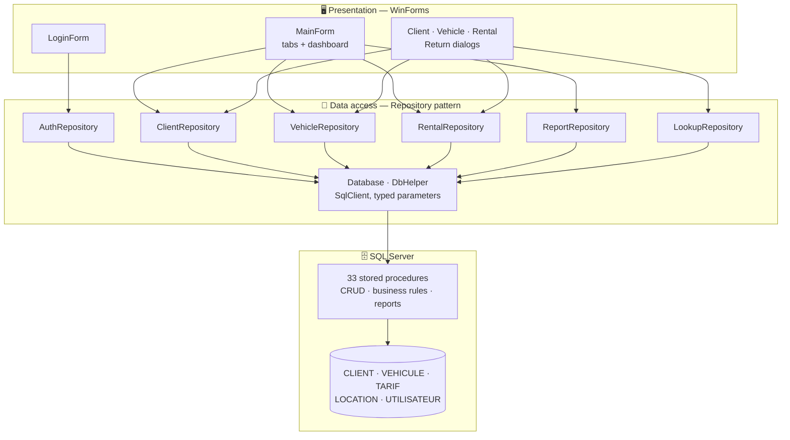
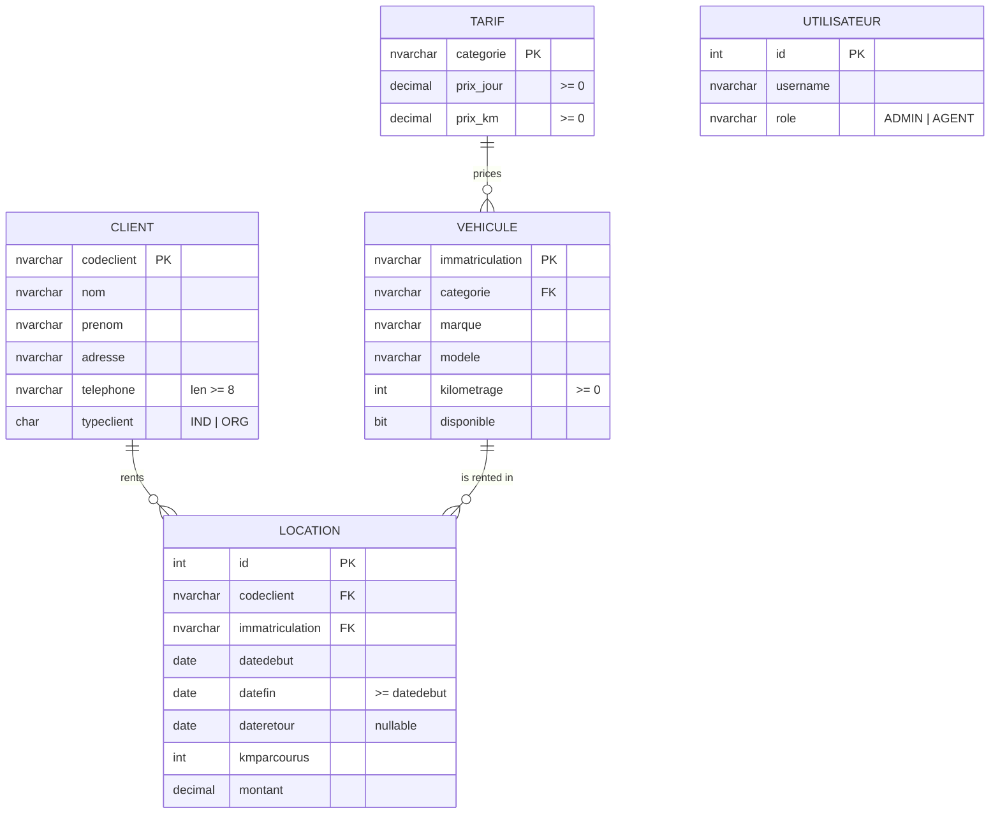
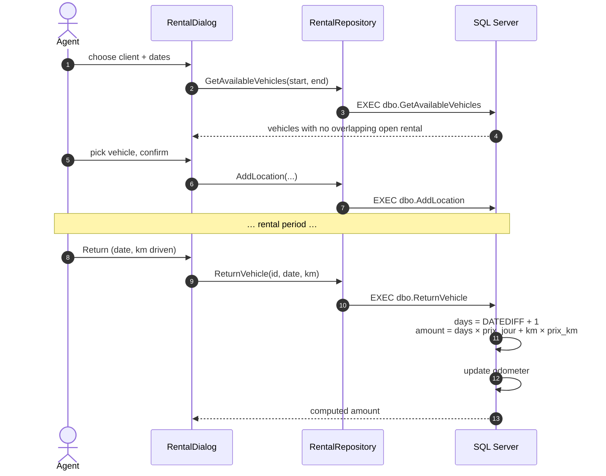

<div align="center">

# 🚗 EVASION — Vehicle Rental Management System

**Desktop rental-agency software: clients, fleet, bookings, returns with automatic billing, and a 9-report analytics dashboard — business logic in SQL Server stored procedures.**

[](https://dotnet.microsoft.com/)
[](https://learn.microsoft.com/dotnet/desktop/winforms/)
[](https://www.microsoft.com/sql-server)
[](https://learn.microsoft.com/sql/connect/ado-net/)
[](database/02_stored_procedures.sql)

*Academic project — Databases / SQL Server*

</div>

---

## 📌 Table of contents

- [Overview](#-overview)
- [Architecture](#-architecture)
- [Data model](#-data-model)
- [Rental lifecycle](#-rental-lifecycle)
- [Reports](#-reports)
- [Quick start](#-quick-start)
- [Project structure](#-project-structure)

---

## 🎯 Overview

| | Feature |
|---|---|
| 🔐 | **Role-based login** — `ADMIN` / `AGENT` |
| 👥 | **Clients** — individuals (`IND`) and organizations (`ORG`), search, CRUD |
| 🚙 | **Fleet** — vehicles by tariff category, mileage, availability |
| 📅 | **Bookings** — only vehicles *actually free* for the chosen dates are offered (overlap check in SQL) |
| ↩️ | **Returns** — amount computed automatically from days × daily rate + km × per-km rate; odometer updated |
| 📊 | **Dashboard** — clients, vehicles, active rentals, total revenue |
| 📈 | **9 business reports** (3 were required) |
| 🛡️ | **Typed SQL parameters everywhere** — no string-built SQL, no injection |

---

## 🏗️ Architecture

Three layers, with the business rules living close to the data:



---

## 🗃️ Data model



Integrity is enforced in the schema with `CHECK` and `FOREIGN KEY` constraints, not only in the UI.

---

## 🔄 Rental lifecycle



**Overlap rule** used by `IsVehicleAvailable`: an open rental (`dateretour IS NULL`) blocks the vehicle when `datedebut ≤ requested_end AND datefin ≥ requested_start`.

---

## 📈 Reports

| Stored procedure | Insight |
|---|---|
| `ReportTotalRentalsPerVehicle` | Rentals per vehicle |
| `ReportMostRentedVehicles` | Top vehicles |
| `ReportRevenuePerCategory` | Revenue by tariff category |
| `ReportCategoryPerformance` | Category KPIs |
| `ReportRevenueByPeriod` | Revenue over a date range |
| `ReportRentalsByClient` | Client history |
| `ReportLoyalClients` | Most loyal clients |
| `ReportPendingRentals` | Vehicles not yet returned |
| `ReportVehicleUsageRate` | Fleet utilization |

---

## 🚀 Quick start

Requirements: Windows, .NET 8 SDK, SQL Server (Express or LocalDB) + SSMS.

```sql
-- in SSMS, run in order
:r database/01_schema.sql              -- tables, constraints, indexes, sample data
:r database/02_stored_procedures.sql   -- CRUD + business logic
:r database/03_reports.sql             -- reporting procedures
```

Set the connection string in `EVASION.WinForms/App.config`, then:

```bash
dotnet run --project EVASION.WinForms
```

Demo accounts: `admin / admin123` (ADMIN) · `agent1 / agent123` (AGENT). Full walkthrough in [`QUICKSTART.md`](QUICKSTART.md).

---

## 📁 Project structure

```
.
├── database/
│   ├── 01_schema.sql              # Schema, constraints, indexes, seed data
│   ├── 02_stored_procedures.sql   # CRUD, availability, return & billing, auth
│   └── 03_reports.sql             # 9 reporting procedures
├── EVASION.WinForms/
│   ├── Forms/                     # Login, Main, Client/Vehicle/Rental/Return dialogs
│   ├── Models/                    # Client, Vehicle, Rental, Tariff, User
│   └── DataAccess/                # Repositories + Database/DbHelper
├── docs/                          # Academic report (LaTeX/Markdown), demo guide
└── TEST_DASHBOARD.sql             # Dashboard verification queries
```

---

## 🗺️ Possible improvements

- Store password **hashes** (e.g. PBKDF2 / `HASHBYTES` + salt) instead of plain text
- Wrap `ReturnVehicle` updates in an explicit transaction
- Export reports to PDF / Excel

---

<div align="center">

**Mohamed Abi** · [GitHub @mohamedabi17](https://github.com/mohamedabi17)

</div>
